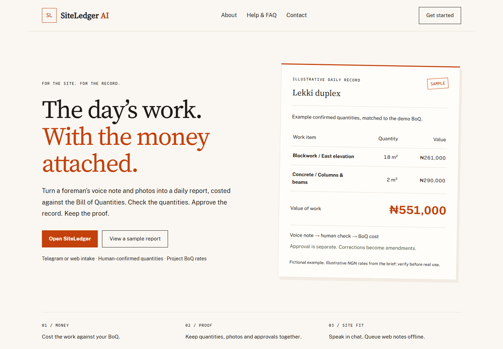
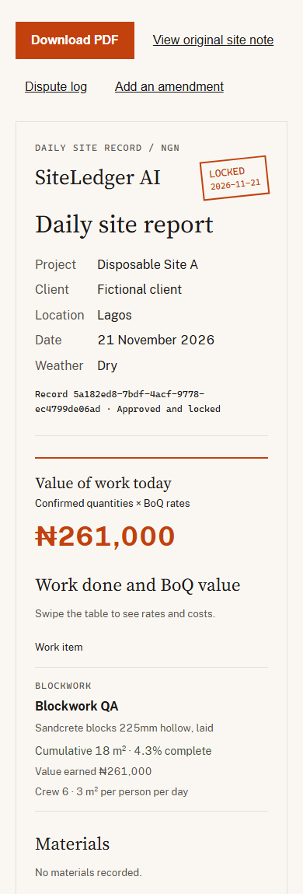
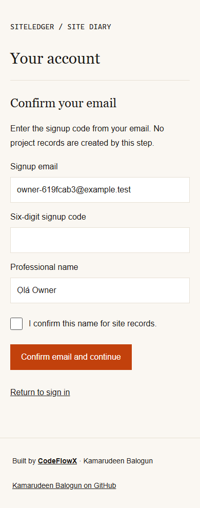
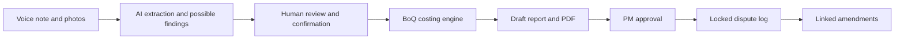

# SiteLedger AI

**Turn a site voice note and photos into a confirmed, costed daily report.**

Built by [CodeFlowX](https://codeflowx.dev) — **Kamarudeen Balogun**, civil engineer and AI & automation builder. [GitHub profile](https://github.com/Kamarudeen-Balogun).

On a building site, yesterday's work can become tomorrow's payment argument. SiteLedger records what was done, checks the quantities with a person, costs them against the project's Bill of Quantities (BoQ), and preserves the approved record with its photos.

The Nigerian demonstration uses naira, Nigerian English and Pidgin. Private projects select their own currency and timezone. Rates come from the supplied BoQ; the AI never invents a price or converts currencies.

## See the product



The public landing page explains the workflow and opens the fictional sample or
private account access. About, Help/FAQ, Contact, Privacy and Terms share its navigation.
Account, project, team and report screens also adapt to desktop widths.




These screenshots use a disposable test project. Construction images are labelled synthetic demonstrations, not genuine site evidence. [Photo provenance](public/demo/photos/PROVENANCE.md).

## How it works

1. **Choose your project.** Sign in on the website or through the Telegram Mini App. Only authorized projects appear.
2. **Send the day's work.** Record or upload a voice note and attach 1–5 photos. The web diary keeps queued files on your device when data drops.
3. **Check the extraction.** Review work items, quantities, crew, materials, delays and possible photo findings. Edit uncertain values and dismiss suggestions you disagree with.
4. **Confirm and cost it.** The engine uses confirmed quantities and supplied BoQ rates to calculate cost, cumulative quantities, completion, variance and productivity.
5. **Review the report.** Open its web view or download the A4 PDF with costs, photos, observations and signature blocks.
6. **Approve and preserve it.** A PM approves the current draft in a separate action. Locked originals cannot be edited or deleted; corrections become linked amendments.



For example, the brief's illustrative blockwork rate is ₦14,500/m². A confirmed 18 m² produces **₦261,000**. Changing an AI suggestion cannot set that rate. The costing engine only ever runs on confirmed values.

## Accounts, projects and Telegram

Create an email/password account, enter its signup email code, and confirm the professional name to appear on records. Recovery uses a separate email code. Names and roles are snapshotted at confirmation, approval and amendment; profile edits preserve old attribution.

First-time Telegram users tap **Open SiteLedger** to use the same secure signup/sign-in form. Keep passwords in that HTTPS form. Website and Telegram access connect through explicit consent and proof of both identities, with expiring, single-use challenges. Existing profiles can be combined deliberately while retaining historical records and permissions.

| Command | What it does |
|---|---|
| `/start` | Get started or see your active project |
| `/account` | Sign in, recover access or manage your connection |
| `/projects` | Choose an authorized project |
| `/today` | Open today's latest note or costed report and item progress |
| `/reports` | Open saved project records |
| `/help` | See the intake and confirmation steps |
| `/logout` | Disconnect Telegram access while preserving records |

Type `/` in the bot chat to see these suggestions. The setup script publishes
and verifies default/private-chat and English menus through Telegram's API,
which updates the same settings as BotFather. Manual `/setcommands` setup is
unnecessary.

Interrupted Telegram uploads retain their original receipts. After access is restored, select the original project and use `/today` to resume queued media. Retries preserve the submission and never overwrite evidence.

| Project access | Permissions |
|---|---|
| Foreman | Submit, confirm, read and amend their own records |
| PM | Submit and confirm; review project records and approve reports |
| Owner | A PM with invitations, membership, ownership transfer and archive/restore controls |

An account can be a foreman on one project and a PM on another. A solo owner/PM can record, confirm and approve their own work through separate actions with honest attribution. Knowing a project code grants no access.

Invitations target a verified email, specify a role, expire after seven days and succeed once. Owners can cancel them. Removal immediately blocks new report, PDF and media requests. Archiving blocks new work while preserving authorized read access; the owner can restore the project.

Consequential account, team and report actions show a review dialog before
saving. Cancel or Escape keeps the action unsaved and returns focus to its
button. Custom unavailable-page screens offer account/project navigation and
retry guidance without exposing private error details.

## Current build status

The core voice/photo → confirmation → costing → PDF → locked log flow is implemented, along with private accounts, projects, teams, secure Telegram linking and recovery. The six public pages and desktop presentation are task 10A2.

New projects start with an **empty BoQ**. The supplied-rate editor and dashboards are task 11. The approved private guest trial is task 10B, following the completed account resilience milestone 10A1. Production deployment and the final demonstration/Kiro write-up remain later milestones. See [the ordered tasks](.kiro/specs/siteledger/tasks.md) and [PROJECT_BRIEF.md](PROJECT_BRIEF.md).

The public `/reports/demo`, `/log/demo` and demo summary expose only the original fictional seed, excluding genuine uploads, private amendments and live totals. Rates are **illustrative, not live market prices**; use QS-verified rates for real work.

## Run locally

Requirements: Node.js 20.9+, npm, Docker and Supabase CLI. Browser acceptance also needs Chromium.

```sh
git clone https://github.com/Kamarudeen-Balogun/siteledger-ai.git
cd siteledger-ai
npm ci
supabase start --exclude "analytics,edge-runtime,functions,imgproxy,inbucket,meta,realtime,studio,vector"
node scripts/configure-local-env.mjs
npm run dev
```

Open <http://localhost:3000>. The local Supabase project is `siteledger-ai`, using API/Postgres ports **55421/55422**. A fresh stack applies migrations and then the seed. The environment helper preserves an existing `.env.local` and prints no keys.

Use `.env.example` for variable names. Fill the three Supabase values from this project's settings, then configure these services.

| Service | Setup |
|---|---|
| Supabase Auth | Enable email/password and Confirm email; configure custom SMTP, three code templates and the Before User Created hook |
| Turnstile | Public site key in the app; secret in Supabase's native CAPTCHA settings |
| Groq | `GROQ_API_KEY` for primary transcription/extraction |
| Gemini | `GEMINI_API_KEY` for photo analysis and optional transcription fallback |
| GonkaRouter | Optional extraction fallback; starter tokens are finite |
| Telegram | Bot token, webhook secret and HTTPS `SITELEDGER_APP_URL` |

Follow [the email and CAPTCHA setup guide](docs/account-email-setup.md). Custom Resend SMTP avoids relying on Supabase's development sender. SiteLedger's sender is separate from the builder's LeadFlowX sender; allowances are shared across that Resend account. No paid upgrade or automatic top-up is configured.

For a development bot, keep the HTTPS tunnel and app running, then:

```sh
npm run telegram:set-webhook -- https://your-app-origin
npm run telegram:configure-menu
npm run setup:verify
```

Menu setup verifies the bot, webhook, account page and database functions before publishing all seven commands in default/private-chat and English scopes. It preserves pending updates and prints no credentials. The workspace's `supabase_siteledger` MCP connection is scoped separately from unrelated projects.

### Offline use

Open your authorized diary online once before taking it offline. Recordings stop at 90 seconds; Ogg, MP3, M4A, WebM and WAV uploads must be below 3 MiB. Photos become JPEGs below 1 MiB each.

Queued files stay in IndexedDB and retry when the diary reconnects or reopens. They retain the captured project, timezone and date. Removal or archival blocks sending and keeps files. Closing the tab does not run a background upload; reopen the diary to continue. Private reports, APIs and media are never cached by the service worker.

## Verify the build

```sh
npm run lint
npm run typecheck
npm run test:costing
npm run test:account
npm run db:check-account-identity
npm run db:check-account-projects
npm run db:check-account-records
npm run db:check-account-telegram
npm run db:check-account-web
npm run db:check-fresh
npm run build
npx playwright install chromium
npm run test:account-browser
node scripts/verify-public-pages.mjs
npm run preview:account-emails
```

Browser acceptance uses a disposable clone with separate native Auth, SMTP, REST and media fixtures. It checks signup/recovery codes, linking, invitations, confirmation, costing, locking/PDF, offline reload/retry and removal. It does not send Resend emails or write genuine evidence. Older report/log/photo/web browser command names now run this account-aware suite.

Artifacts remain under ignored `supabase/.temp/task-10a/`. [Task 10A evidence](.kiro/specs/siteledger/task-10a-handoff.md) records actual checks. Offline emulation and scripted findings establish workflow behavior, not real-site speech or defect accuracy. [Language coverage](docs/voice-languages.md) separates provider support from tested recordings.

Public page verification uses a running local preview on port 3011. Set
`SITELEDGER_PUBLIC_QA_URL` to another localhost origin when needed. It checks
390/768/1440px layouts, internal links, keyboard controls and the labelled cost
illustration; screenshots are saved in `supabase/.temp/task-10a2/`.

## Architecture

| Layer | Implementation |
|---|---|
| Web | Next.js App Router, TypeScript, Tailwind |
| Data/media | Supabase Postgres and private Storage |
| Accounts | Native Supabase Auth with opaque HttpOnly app sessions |
| AI | Server-only `transcribeAndExtract()` and `analysePhoto()` |
| Money | Pure exact-decimal `costReport(items, priceList)` |
| Reports | Web documents and server-generated React PDFs |
| Intake | Telegram webhook and IndexedDB web queue |
| Evidence | Immutable locked reports, amendments and separate admin audit |

Source: `app/`, `components/`, `lib/`. Schema, seed and templates: `supabase/`. Verification: `tests/`, `scripts/`. Secrets stay outside Git and client code.

## Kiro evidence

The builder completed real Kiro reviews of [task 4](.kiro/specs/siteledger/task-4-review.md), [task 5](.kiro/specs/siteledger/task-5-review.md), [task 6](.kiro/specs/siteledger/task-6-review.md), [task 7](.kiro/specs/siteledger/task-7-review.md) and [task 8](.kiro/specs/siteledger/task-8-review.md). Specs, steering, hook definitions and prepared Voice/Vision/Costing/Safety Crew roles are tracked in `.kiro/`.

[The hook investigation](docs/kiro-hook-follow-up.md) distinguishes manual commands from unobserved automatic execution. Successful hook and Crew execution are not claimed. The builder reported exhausted initial credits and a pending 4,000-credit request on 21 November. Codex work is identified separately in handoffs; the final Kiro write-up remains task 14.

Submission target: **3 December 2026**. Deadline: **4 December 2026, 23:00 WAT**, as recorded in the brief.
